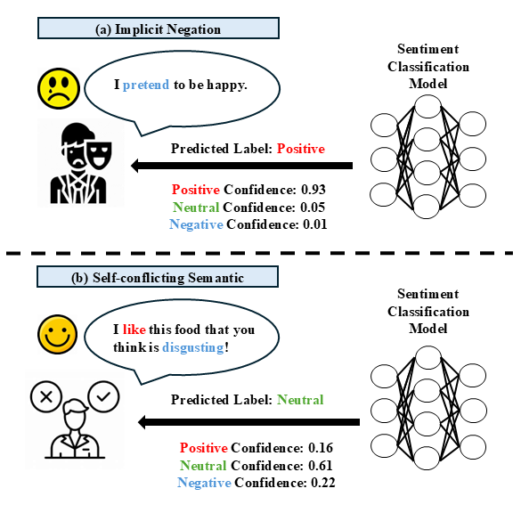
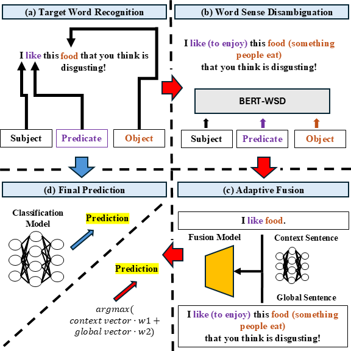

# COMP550 WSD-AF for Sentiment Analysis

Welcome! This repository contains the official code for the final project of COMP550: Natural Language Processing at McGill University. Below, you'll find an overview of our project.

---

## Motivation

<div align="center">
  
  <p><b>Figure 1:</b> Illustration of the Motivation behind our project.</p>
</div>

In everyday life, we encounter many noisy sentences with hidden semantics that can be challenging to understand, even for highly educated individuals. These noisy inputs may come from young children, people with speech disabilities, or individuals with autism. Accurately extracting sentiments from these inputs is crucial for better understanding and addressing the needs of these groups, potentially contributing to solutions for various social issues.

Our project addresses the limitations of text classification models in adversarial and noisy contexts. Specifically:

- **Implicit Negation**: Sentences like "I pretend to be happy" contain subtle negations that current deep neural network (DNN) models struggle to classify correctly. BERT-based models, even after fine-tuning, often fail to capture the nuanced text distribution of such inputs.

- **Self-Conflicting Semantics**: Inputs with conflicting semantics (e.g., "I love the service, but the food was terrible.") confuse classifiers, leading to degraded performance. These scenarios highlight the need for improved methods to identify true sentiments amidst noise.

---

## Method: WSD-AF

<div align="center">
  
  <p><b>Figure 2:</b> Framework of the WSD-AF model combining Adaptive Fusion and Word Sense Disambiguation.</p>
</div>

To address these challenges, we propose **WSD-AF**, a method combining adaptive fusion and word sense disambiguation:

1. **Adaptive Fusion (AF)**: A weight generation network (Fusion Model) adaptively assigns weights to:
   - **Global Semantic Vector**: Captures the overall sentiment of the input.
   - **Context Semantic Vector**: Focuses on sentences with core components.
   This fusion enhances classification performance in adversarial contexts by balancing these two semantic vectors.

2. **Word Sense Disambiguation (WSD)**: By integrating WSD, we provide richer context, enabling the model to reduce noise and better recognize explicit semantics in noisy sentences.

---

## Running the Code

The project includes four evaluation modes: **Baseline**, **WSD**, **AF**, and **WSD-AF**. Switch between modes freely to explore their effects.

### Steps to Execute

1. **Load and Preprocess Sentiment Model Dataset**
    - We use two datasets for our experiments:
        - **Sentiment Analysis Dataset (SAD)**
        - **Hospital Review Dataset (HRD)**
    - Run the following command:
    ```bash
    python SAD_main.py
    ```
    or
    ```bash
    python HRD_main.py
    ```

2. **Fine-Tune the BERT-Based Classifier**
    - We fine-tune **BERT-base-uncased** and **RoBERTa-base** models.
    - Modify the model name in the corresponding Python file if needed.

3. **Load and Process Fusion Dataset**
    - The Fusion dataset (MC dataset) consists of:
        - 150 training samples for SAD and 100 for HRD
        - 60 test samples for SAD and 40 for HRD
    - These samples were generated using ChatGPT and manually crafted.

4. **Combine Sentiment and Fusion Datasets for Evaluation**
    - To ensure fair comparisons, we augment the sentiment datasets with the MC dataset, simulating noisy inputs.

5. **Train Alpha Calculator (for "AF" or "WSD-AF" Modes)**
    - Uncomment the relevant code in the script if you wish to evaluate using "AF" or "WSD_AF" modes.

6. **Final Evaluation**
    - Evaluate the methods (Baseline, WSD, AF, WSD_AF) based on metrics like accuracy, recall, precision, and F1-score.

---

## Contributions

### Mandy Huang
- Co-authored the abstract and introduction.
- Designed the experimental setup, including models, datasets, metrics, and fine-tuning parameters.
- Implemented the model fine-tuning code and handled dataset cleaning/loading.
- Presented experimental results, including model performance and limitations.

### Fengfei Yu
- Led the project, including manuscript and code development.
- Co-authored the abstract, motivation, and WSD-AF framework.
- Designed and implemented the fusion model, disambiguation-related code, and dependency parsing.
- Proposed techniques for handling noisy/conflicting inputs and created all visual figures.

### Danlin Luo
- Authored the related work section and contributed to the introduction.
- Focused on training and fine-tuning models on the HRD dataset.
- Implemented target word recognition code and managed paper formatting.

---

We hope this README provides clarity on the project and helps you navigate the codebase. Happy exploring!

---

## MAMS Joint Multi-Aspect Extension

The `experiments/mams_joint_relations.py` runner treats MAMS-ATSA as a
sentence-level structured prediction problem. It jointly models every aspect
in a sentence with:

- gated multi-head attention across aspect representations;
- a differentiable sentiment-diversity objective;
- pairwise same/different sentiment supervision;
- exact sentence-level constrained decoding.

The validation-locked model reaches **86.7724 Macro-F1** and **87.2006
accuracy** on the MAMS test split. This is a significant 2.60-point improvement
over the original 84.17 baseline and is numerically tied with the reported
86.77 SVM-ATSA result.

Install the experiment dependencies:

```bash
pip install -r experiments/requirements-joint.txt
```

Select the checkpoint and decoder on the official validation split:

```bash
python experiments/mams_joint_relations.py --epochs 5
```

After locking the best epoch and pair decoder, reproduce the final
train-plus-validation run:

```bash
python experiments/mams_joint_relations.py \
  --epochs 3 \
  --train-on-validation \
  --fixed-pair-decode-weight 0.1 \
  --evaluate-test
```

The runner downloads the official MAMS XML files automatically and requires a
CUDA-capable GPU. Detailed results and ablations are documented in
`experiments/results/mams_joint_relations_report.md`.

---

## Sense-Conditioned Relation Attention

`experiments/mams_sense_relational.py` models every aspect in a sentence with
relation attention and one sentiment cross-entropy objective. It also contains
controlled WSD pair-bias and aspect-to-scope pooling ablations.

The relation-only refit reaches **87.5784 test Macro-F1**. The WSD-conditioned
and scope-pooling variants improve individual validation runs but do not
survive train-plus-validation refitting, so they remain honest ablations rather
than the recommended primary model.

Cross-relative attention reaches 86.4116 validation Macro-F1, but its strongest
matched refit reaches only 86.7764 on test. Residual-logit correction reaches
85.6212 on validation and 86.2870 on test. Neither replaces the simpler
relation-only model. These follow-ups are exploratory because earlier MAMS
test results were already known.

See `experiments/README.md` for setup, reproduction commands, and result
tables. The detailed run report is in
`experiments/results/mams_sense_relational_report.md`.
